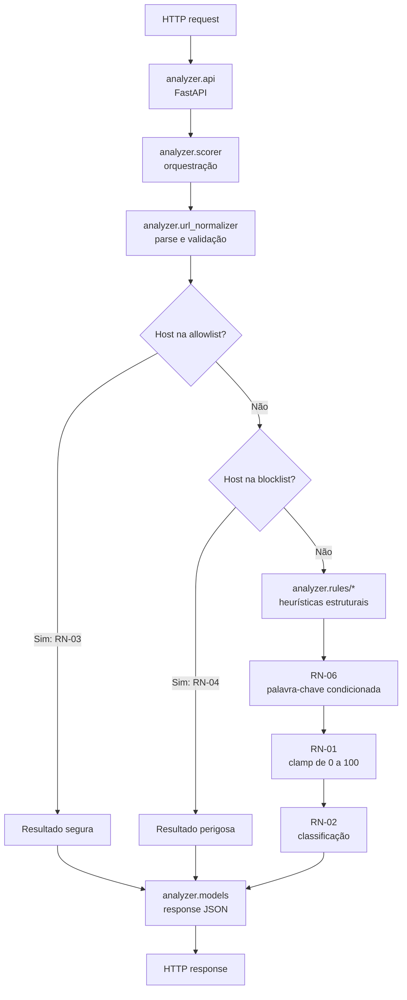

# PhishGuard

> Serviço HTTP para análise local e determinística de URLs suspeitas e de phishing.

**Bootcamp III — Turma B-0726 | Entrega 3**

[](https://github.com/mariisena/phishguard-bootcamp-iii/actions/workflows/ci.yml)

## Visão geral

O PhishGuard recebe uma URL por HTTP e retorna uma pontuação de risco entre 0 e 100, uma
classificação (`segura`, `suspeita` ou `perigosa`) e uma lista ordenada de motivos. A análise é
feita com regras locais, sem consulta a serviços externos.

| Classificação | Faixa de score |
| --- | ---: |
| `segura` | 0–29 |
| `suspeita` | 30–59 |
| `perigosa` | 60–100 |

As regras cobrem host IP, `@` na autoridade, excesso de subdomínios, TLD suspeito, encurtadores,
impersonação de marca, Punycode/Unicode, ausência de HTTPS, URL longa e palavras-chave sensíveis.
Os pesos, motivos e critérios normativos estão na [Tabela 4.1 e §4.2 do SDD](docs/SDD.md).

## Fluxo da aplicação

As verificações nas listas podem encerrar a análise antes das heurísticas. A allowlist tem
prioridade sobre a blocklist, conforme RN-03 e RN-04.



## Arquitetura

A decomposição segue o [§6 do SDD](docs/SDD.md) e a interface comum de heurísticas do §6.1.
As responsabilidades também se relacionam às regras de pontuação da Tabela 4.1, aos critérios e
listas da Tabela 4.2/§4.2, às RN-01 a RN-06 e aos contratos HTTP do §5.

| Módulo/componente | Responsabilidade |
| --- | --- |
| `analyzer/api.py` | Rotas FastAPI (`POST /api/v1/analyze` e `GET /health`), conversão dos erros previstos para HTTP 422 e serialização da resposta. |
| `analyzer/models.py` | Modelos Pydantic dos contratos JSON de request, análise e health. |
| `analyzer/url_normalizer.py` | Validar e normalizar URLs; produzir a representação estruturada usada pelas regras. |
| `analyzer/scorer.py` | Orquestrar normalização, precedência allowlist → blocklist → heurísticas, soma dos pontos, RN-06, clamp da RN-01 e classificação da RN-02. |
| `analyzer/blocklist.py` | Carregar e consultar as listas locais de allowlist e blocklist. |
| `analyzer/rules/*.py` | Implementar cada heurística como unidade independente; os módulos ficam em `analyzer/rules/`. |
| `analyzer/config.py` | Centralizar pesos, limiares, listas fechadas e ordem das heurísticas. |
| `data/allowlist.json` e `data/blocklist.json` | Fornecer as listas locais usadas pelo analisador. |

As heurísticas são unidades isoladas e testáveis, conforme o §6.1. O scorer aplica a ordem
normativa e as regras de negócio; alterações de comportamento devem partir do SDD.

## Instalação e execução

### Pré-requisitos

- Docker Engine com o comando `docker compose`, para a execução conteinerizada; ou
- Python 3.11 e `pip`, para a execução local.

### Variáveis de ambiente

A aplicação não precisa de variáveis de ambiente: não é necessário criar um arquivo `.env`,
configurar chaves ou conectar serviços externos. O projeto usa regras locais, sem serviços externos
([ADR-0002](docs/adr/0002-heuristicas-vs-ml.md)), e é stateless, sem banco de dados
([ADR-0003](docs/adr/0003-stateless-sem-banco.md)). No `docker-compose.yml`, o serviço `api` define
somente `PYTHONUNBUFFERED=1`, para que a saída do Python não seja armazenada em buffer; o serviço
`test` não define variáveis de ambiente.

### Docker

Na raiz do repositório, construa a imagem e suba a API:

```bash
docker compose up --build
```

A porta `8000` do host é mapeada para a porta `8000` do container. A API estará em
`http://localhost:8000`, e o Swagger UI em `http://localhost:8000/docs`.

Em outro terminal, execute a suíte no serviço `test`. O `pytest.ini` configura a cobertura de
branches e imprime no terminal o relatório com linhas não cobertas:

```bash
docker compose run --rm test
```

O serviço `api` inicia `analyzer.api:app`; o serviço `test` executa `python -m pytest -v`, conforme
o [docker-compose.yml](docker-compose.yml).

### Ambiente local

#### Windows (PowerShell)

Clone o repositório oficial:

```bash
git clone https://github.com/mariisena/phishguard-bootcamp-iii.git
cd phishguard-bootcamp-iii
```

Crie e ative um ambiente virtual com Python 3.11:

```powershell
py -3.11 -m venv .venv
.\.venv\Scripts\Activate.ps1
```

Instale as dependências:

```bash
python -m pip install -r requirements.txt
```

Suba a API:

```bash
uvicorn analyzer.api:app --reload --host 127.0.0.1 --port 8000
```

A API fica disponível em `http://localhost:8000`. Abra
[`http://localhost:8000/docs`](http://localhost:8000/docs) para acessar o Swagger UI.

#### Linux/macOS

Na raiz do repositório, crie e ative o ambiente virtual com Python 3.11:

```bash
python3.11 -m venv .venv
source .venv/bin/activate
```

Instale as dependências:

```bash
python -m pip install -r requirements.txt
```

Suba a API:

```bash
uvicorn analyzer.api:app --reload --host 127.0.0.1 --port 8000
```

A API fica disponível em `http://localhost:8000`. Abra
[`http://localhost:8000/docs`](http://localhost:8000/docs) para acessar o Swagger UI.

### Testes locais

Em Linux/macOS, com o ambiente virtual ativado, execute o harness a partir da raiz do repositório
com Bash:

```bash
./scripts/run_harness.sh
```

O script executa `pytest -v` e grava o log em `logs/`. O `pytest.ini` habilita cobertura de branches
e imprime no terminal o relatório com linhas não cobertas.

### Cobertura

Ao executar os testes, consulte no terminal a tabela de cobertura por arquivo: a coluna `Stmts`
mostra as instruções, `Miss` as não executadas e `Cover` a porcentagem coberta. A coluna `Missing`
indica as linhas que ainda não foram cobertas.

Na CI, abra uma execução do workflow [**CI** no GitHub Actions](https://github.com/mariisena/phishguard-bootcamp-iii/actions/workflows/ci.yml)
e baixe o artefato `evidencias-test-harness`. Após descompactá-lo, abra
`htmlcov/index.html` para consultar o relatório navegável. O artefato fica disponível por 30 dias.

### Endpoints

- `POST /api/v1/analyze` — analisa uma URL enviada em JSON.
- `GET /health` — retorna o estado de disponibilidade.
- `GET /docs` — documentação interativa Swagger UI.

Os exemplos abaixo foram executados contra a API local em `http://localhost:8000`.

```bash
curl -sS -X POST http://localhost:8000/api/v1/analyze -H 'Content-Type: application/json' -d '{"url":"https://google.com"}'
```

Resposta real — classificação `segura`:

```json
{
  "url": "https://google.com",
  "normalized_host": "google.com",
  "score": 0,
  "classification": "segura",
  "reasons": [
    "dominio_allowlist"
  ]
}
```

```bash
curl -sS -X POST http://localhost:8000/api/v1/analyze -H 'Content-Type: application/json' -d '{"url":"http://192.168.0.1/login"}'
```

Resposta real — classificação `suspeita`:

```json
{
  "url": "http://192.168.0.1/login",
  "normalized_host": "192.168.0.1",
  "score": 55,
  "classification": "suspeita",
  "reasons": [
    "host_ip",
    "sem_https",
    "palavra_chave_sensivel_no_path_query"
  ]
}
```

```bash
curl -sS -X POST http://localhost:8000/api/v1/analyze -H 'Content-Type: application/json' -d '{"url":"http://phishing-banco-teste.com"}'
```

Resposta real — classificação `perigosa`:

```json
{
  "url": "http://phishing-banco-teste.com",
  "normalized_host": "phishing-banco-teste.com",
  "score": 100,
  "classification": "perigosa",
  "reasons": [
    "dominio_blocklist"
  ]
}
```

Também é possível explorar o contrato e enviar requisições pelo Swagger UI em
[`http://localhost:8000/docs`](http://localhost:8000/docs).

## Evidências

- Workflow de CI: [](https://github.com/mariisena/phishguard-bootcamp-iii/actions/workflows/ci.yml) (`CI`, definido em `.github/workflows/ci.yml`).
- Suíte local verificada: **246 testes passaram**.
- Relatório de execução dos testes da Entrega 2 (#98): [docs/evidencias/relatorio_testes_entrega2.md](docs/evidencias/relatorio_testes_entrega2.md)

## Documentação e links

- Especificação técnica (SDD): [docs/SDD.md](docs/SDD.md)
- Índice das decisões arquiteturais (ADRs): [docs/adr/README.md](docs/adr/README.md)
- Inspeção e correção de erros lógicos (#99): [docs/registro_correcoes/erros_logicos.md](docs/registro_correcoes/erros_logicos.md)
- Re-especificação (#100): [docs/re_especificacao.md](docs/re_especificacao.md)
- Diretrizes para agentes de IA: [docs/AI_AGENTS.md](docs/AI_AGENTS.md)
- Análise comparativa de ferramentas de IA (#104): [docs/relatorio_ia/analise_comparativa.md](docs/relatorio_ia/analise_comparativa.md)
- Relatório de ética e segurança do uso de IA (#105): [docs/relatorio_ia/etica_seguranca.md](docs/relatorio_ia/etica_seguranca.md)

## Release

A Release `v3.0.0`:
[Release v3.0.0](https://github.com/mariisena/phishguard-bootcamp-iii/releases/tag/v3.0.0). 
O badge da CI já está no início deste README.

## Equipe

| Nome | GitHub |
| --- | --- |
| Mariana Sena | [@mariisena](https://github.com/mariisena) |
| Ana Clara Carvalho | [@anaacllara](https://github.com/anaacllara) |
| Matheus Henrique Silva| [@mhsilvaworks](https://github.com/mhsilvaworks) |
| Henrique Guimarães| [@Henrique-GG](https://github.com/Henrique-GG) |

## Estrutura do projeto

```text
phishguard-bootcamp-iii/
├── .claude/
│   ├── commands/
│   │   └── commit.md
│   └── rules/
│       ├── codigo.md
│       ├── seguranca.md
│       └── testes.md
├── .dockerignore
├── .gitattributes
├── .github/
│   ├── PULL_REQUEST_TEMPLATE.md
│   └── workflows/ci.yml
├── .gitignore
├── analyzer/
│   ├── __init__.py
│   ├── api.py
│   ├── blocklist.py
│   ├── config.py
│   ├── models.py
│   ├── rules/
│   │   ├── __init__.py
│   │   ├── at_symbol.py
│   │   ├── brand_impersonation.py
│   │   ├── excessive_subdomains.py
│   │   ├── ip_domain.py
│   │   ├── missing_https.py
│   │   ├── punycode_homograph.py
│   │   ├── suspicious_keywords.py
│   │   ├── suspicious_tld.py
│   │   ├── url_length.py
│   │   └── url_shortener.py
│   ├── scorer.py
│   ├── url_normalizer.py
├── data/
│   ├── allowlist.json
│   └── blocklist.json
├── docker-compose.yml
├── Dockerfile
├── docs/
│   ├── AI_AGENTS.md
│   ├── SDD.md
│   ├── adr/
│   │   ├── README.md
│   │   ├── 0001-linguagem-e-framework.md
│   │   ├── 0002-heuristicas-vs-ml.md
│   │   ├── 0003-stateless-sem-banco.md
│   │   ├── 0004-docker-padronizacao-ambiente.md
│   │   ├── 0005-agente-ia-claude-code.md
│   │   ├── 0006-subdominios-sem-public-suffix-list.md
│   │   ├── 0007-marca-por-inclusao-e-leet-speak.md
│   │   ├── 0008-contrato-deterministico-sem-checked-at.md
│   │   └── 0009-ci-github-actions.md
|   ├── evidencias/
│   │   ├── relatorio_testes_entrega2.md
│   ├── re_especificacao.md
│   ├── registro_correcoes/
│   │   ├── correcoes_10_09.md
│   │   └── erros_logicos.md
│   └── relatorio_ia/
│       └── etica_seguranca.md
├── logs_test_harness.txt
├── Linha_Tempo.md
├── CHECKLIST_ENTREGAS.md
├── CLAUDE.md
├── README.md
├── scripts/
│   └── run_harness.sh
└── tests/
│   ├── integration/
│   │   ├── test_api.py
│   │   ├── test_detector.py
│   │   └── test_performance.py
│   └── unit/
│       ├── test_at_symbol.py
│       ├── test_blocklist.py
│       ├── test_brand_impersonation.py
│       ├── test_config_consistency.py
│       ├── test_excessive_subdomains.py
│       ├── test_ip_domain.py
│       ├── test_missing_https.py
│       ├── test_punycode_homograph.py
│       ├── test_scorer.py
│       ├── test_suspicious_keywords.py
│       ├── test_suspicious_tld.py
│       ├── test_url_length.py
│       ├── test_url_normalizer.py
│       └── test_url_shortener.py
├── pytest.ini
├── requirements.txt
```

## Licença
Decisao pendente a discutir com grupo.
