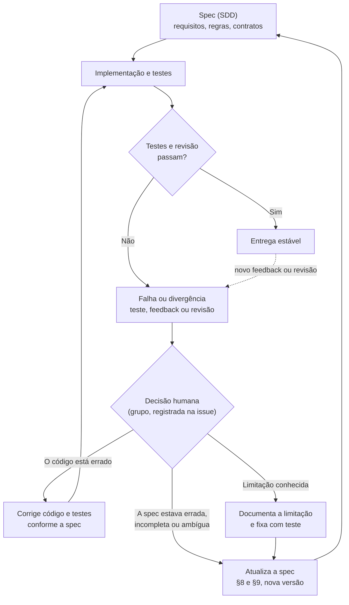

# Loop de Re-especificação

> Registro das situações em que o SDD (`docs/SDD.md`) precisou ser reajustado por causa de testes, feedback ou revisão, com o gatilho, a decisão e o impacto de cada mudança.

**Data de elaboração**: 2026-10-12
**Issue de origem**: #100 (parte de #95)
**Documentos relacionados**: `docs/SDD.md` (§8 Refinamento por Feedback, §9 Histórico de Versões)

O §8 e o §9 do SDD já registram essas mudanças, mas de forma resumida e sem a análise de causa. Este documento complementa esses registros: mostra o **caminho** (do gatilho à decisão) e discute **por que** a especificação mudou em cada caso.

---

## 1. O loop

O SDD é a fonte da verdade, mas não é imutável. Quando um teste falha, um feedback chega ou uma revisão encontra divergência, **uma pessoa decide** o que muda: a spec, o código ou nada (limitação aceita). Só depois a mudança volta para a spec, que é versionada, e o ciclo recomeça.

**Regra do fluxo** (ver `CLAUDE.md`): havendo divergência entre código, teste e especificação, a especificação é revisada **antes** de o comportamento ser alterado. A decisão humana é o ponto de controle do loop: nenhum teste vermelho altera a spec sozinho.

---

## 2. Registro de re-especificações

| Gatilho (teste/feedback/revisão) | O que estava na spec | O que mudou | Impacto em código/testes | Issue/PR | Versão do SDD |
| --- | --- | --- | --- | --- | --- |
| **Feedback/teste:** `analyzer/config.py` já continha listas maiores que as do §4.2; SDD e código divergiam. | §4.2 com listas curtas: 6 TLDs suspeitos (`.zip`, `.top`, `.xyz`, `.country`, `.click`, `.link`); 4 encurtadores (`bit.ly`, `tinyurl.com`, `t.co`, `is.gd`); marcas com menos domínios oficiais (ex.: `microsoft` só com `microsoft.com`; `apple` e `amazon` ausentes). | Listas do §4.2 ampliadas para casar com o `config.py`: +7 TLDs (`.work`, `.gq`, `.tk`, `.ml`, `.cf`, `.mom`, `.fit`), +5 encurtadores (`goo.gl`, `ow.ly`, `buff.ly`, `cutt.ly`, `rebrand.ly`), `microsoft` com `live.com` e `office.com`, e `apple` e `amazon` incluídas. | **Código:** nenhum. **Testes:** novo `tests/test_config_consistency.py`, que compara SDD e `config.py` para que não voltem a divergir. A spec se adaptou ao código. | Issue #58 / PR #71 | v1.2 |
| **Feedback/teste:** o exemplo normativo do SDD (`paypa1-secure.verify-account.top`, teste `test_exemplo_normativo_do_sdd` em `tests/test_scorer.py`) só atinge o score esperado se houver normalização leet speak. | RN-05 descrevia a comparação "case-insensitive" do nome da marca no host, sem mencionar leet speak. A regra contradizia o exemplo e o comportamento implementado. | RN-05 passa a incluir normalização leet speak básica (0→o, 1→l, 3→e, 4→a, 5→s, 7→t) antes da comparação. O texto sobre typosquatting foi reescrito: o typosquatting ortográfico genérico segue fora de escopo. | **Código:** nenhum. **Testes:** nenhum alterado; `test_exemplo_normativo_do_sdd` já dependia do comportamento. A spec se adaptou ao código. | Issue #59 / PR #72 | v1.2 |
| **Revisão:** inconsistência interna do SDD entre o exemplo do §5.2 e a Tabela 4.1. | Exemplo de response do §5.2 usava o motivo `palavra_chave_sensivel_no_path`. A Tabela 4.1 (normativa) define `palavra_chave_sensivel_no_path_query`. | Exemplo do §5.2 corrigido para o código normativo `palavra_chave_sensivel_no_path_query`. | **Código:** nenhum (já usava a convenção da Tabela 4.1). **Testes:** nenhum. Correção puramente documental. | Issue #60 / PR #76 | v1.2 |
| **Feedback:** `data/allowlist.json` e `data/blocklist.json` estavam vazios (`[]`) e o escopo das listas não estava definido. | RF-15 e RN-03/RN-04 definiam a lógica, mas não o conteúdo inicial nem o escopo das listas. | Definido o escopo e o conteúdo inicial: allowlist com domínios canônicos (`google.com`, `github.com`, `gov.br`, `microsoft.com`, `paypal.com`, `apple.com`, `amazon.com`); blocklist com 3 domínios fictícios de teste. | **Código:** nenhum. **Dados:** dois arquivos JSON populados. **Testes:** sem teste novo neste PR. Registrado só no §9 (sem entrada correspondente no §8). | Issue #61 / PR #77 | v1.2 |
| **Revisão:** auditoria de consistência entre SDD, código e testes no início da Entrega 2. | Divergências documentais: RF-01 citava endpoint incorreto; exemplo do §5.2 trazia `checked_at`; URLs dos exemplos com sintaxe de link Markdown; §6 com localização antiga das heurísticas; §7 com referências de regra trocadas; itens duplicados no §1.1. | Corrigidos: endpoint `POST /api/v1/analyze` no RF-01; `checked_at` retirado do exemplo; URLs limpas; §6 aponta para `analyzer/rules/`; §7 passa a citar RN-05 e RN-06; duplicatas removidas do §1.1. Sem alteração de regra de negócio, peso, limiar ou lista. | **Spec:** só documentação; `CLAUDE.md` e `docs/AI_AGENTS.md` com caminhos corrigidos no mesmo PR. **Código:** remoção de `checked_at` de `models.py`/`api.py` tratada separadamente no PR #86, seguindo a spec já corrigida. **Testes:** nenhum neste PR. | PR #85 (código: PR #86) | v1.3 |
| **Revisão (levantado no PR #88):** o RF-09 compara o host por igualdade exata; `https://www.bit.ly/x` não dispara e recebe score 0 (`segura`). O SDD não dizia se isso era intencional. | RF-09 e §4.2 sem posição sobre subdomínios de encurtadores. Na prática, só o host idêntico ao encurtador disparava. | **Decisão do grupo (opção B):** subdomínios (`www.bit.ly`, `m.bit.ly`) passam a disparar: host igual ao encurtador ou terminado em `.<encurtador>`. A atualização do SDD (§4.2, RF-09, §8 e §9) deve preceder o código. | **Código (previsto):** ajuste em `analyzer/rules/url_shortener.py`. **Testes (previstos):** casos positivo (`www.bit.ly`), negativo (`notbit.ly`) e de borda (`bit.ly.evil.com`) em `tests/test_url_shortener.py`. A spec muda **antes** do código. | Issue #90 | Atual (pós-v1.3) |
| **Revisão (levantado no PR #88):** falso positivo da RN-05: `capitaurbana.com` dispara `possivel_impersonacao_marca:itau` (score 25) e `caixadesom.com` dispara para `caixa`. | RN-05 detecta impersonação por inclusão do nome da marca no host. §1.1 deixa typosquatting avançado fora de escopo, mas nenhum trecho registrava este caso como limitação. | O comportamento **não muda**. Entra no SDD (§4.2 ou §1.1) uma nota de **limitação conhecida** com os exemplos, registrada no §8 e no §9. Evolução futura: correspondência por fronteira de palavra ou distância de edição. | **Código:** nenhum. **Testes (previsto):** `tests/test_brand_impersonation.py` ganha um teste com nome claro (ex.: `test_limitacao_conhecida_marca_contida_em_palavra_dispara`) para que qualquer mudança futura seja decisão consciente. | Issue #91 | Atual (pós-v1.3) |
| **Revisão:** o §7.1 sugere `tests/unit/`, `tests/integration/` e `tests/evidence/`, mas a pasta `tests/` continua plana. A #66 foi fechada como concluída sem realizar a reorganização. | §7.1 descreve a organização sugerida em subpastas. O repositório mantém todos os testes direto em `tests/`. | **Decisão do grupo (opção A):** reorganizar a suíte para convergir com o §7.1 em vez de ajustar o texto à estrutura atual. O código/estrutura se adapta à spec. | **Estrutura (prevista):** mover arquivos com `git mv` e conferir `pytest.ini`, `scripts/run_harness.sh`, `Dockerfile` e `.github/workflows/ci.yml`; definir onde ficam as evidências, alinhado ao RNF-06. O mesmo número de testes (241 pós-PR #88) deve passar. | Issue #92 (relacionada à #66) | Atual (pós-v1.3) |

**Notas sobre o registro**

- As linhas de #90, #91 e #92 registram a **decisão** tomada na issue. O SDD (§8 e §9), o código e os testes correspondentes ainda **não** foram atualizados. A coluna "Impacto" descreve o impacto previsto.
- A v1.1 (numeração das RN, conflito de SLA, contrato 400 → 422) consta no §9, mas sem issue ou PR associado, e por isso fica fora desta tabela.
- Os números #58–#61 são issues; os PRs correspondentes foram identificados pelo histórico do git (#71, #72, #76, #77). O #85 é um